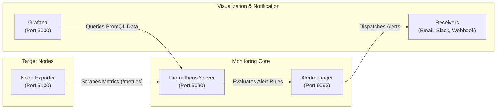

# DevOps Tools & Infrastructure Installation Guides

A centralized documentation repository containing step-by-step, production-ready installation guides, configuration files, systemd services, and troubleshooting references.

---

## Tool Reference Matrix

| Tool | Category | Default Port | Service Name | Default Credentials | Documentation Guide |
| :--- | :--- | :--- | :--- | :--- | :--- |
| **Prometheus** | Monitoring & Time-Series | `9090` | `prometheus.service` | *N/A (Open)* | [Prometheus Guide](Prometheus.md) |
| **Node Exporter** | Host Metrics Collector | `9100` | `node_exporter.service` | *N/A (Open)* | [Node Exporter Guide](Node%20Exporter.md) |
| **Alertmanager** | Alert Routing & Deduplication | `9093` | `alertmanager.service` | *N/A (Open)* | [Alertmanager Guide](alert%20manager.md) |
| **Grafana** | Visualization & Dashboards | `3000` | `grafana-server.service` | `admin` / `admin` | [Grafana Guide](grafana.md) |
| **SonarQube** | Code Quality & Security | `9000` | `sonarqube.service` | `admin` / `admin` | [SonarQube Guide](SonarQube%20Installation.md) |
| **Certbot** | SSL/TLS Automation (Let's Encrypt) | `80`, `443` | `certbot.timer` | *N/A* | [Certbot Guide](install%20certbot.md) |
| **HashiCorp Packer** | Machine Image Builder (AMI/VM) | *CLI* | *N/A* | *N/A* | [Packer Guide](hashicorp%20packer%20installation.md) |
| **Crontab on Windows** | Task Automation (Git Bash/WSL) | *N/A* | Task Scheduler | *N/A* | [Crontab Windows Guide](crontab%20on%20Windows.md) |
| **PostgreSQL Backup** | WSL2 <-> Windows DB Automation | `5432` | `postgresql.service` | `postgres` | [PostgreSQL Backup Guide](automatic%20crontab.md) |

---

## Monitoring Stack Architecture



---

## Directory Index

- 📊 **[Prometheus](Prometheus.md)**: Time-series database and scraping engine. Includes non-root service user, systemd service with `--web.enable-lifecycle`, configuration validation via `promtool`, and firewall rules.
- 💻 **[Node Exporter](Node%20Exporter.md)**: Linux OS metrics exporter. Includes correct `tar` extraction syntax, unprivileged service execution, and Prometheus scrape config.
- 🚨 **[Alertmanager](alert%20manager.md)**: Deduplication and routing for Prometheus alerts. Includes baseline routing configuration and systemd service.
- 📈 **[Grafana](grafana.md)**: Analytics dashboards. Includes APT and YUM repository setup, systemd enablement, port 3000 firewall configuration, and CLI password resets.
- 🛡️ **[SonarQube](SonarQube%20Installation.md)**: Static code analysis server. Includes critical Linux kernel parameters (`vm.max_map_count`), PostgreSQL database setup, permissions, and systemd service.
- 🔒 **[Certbot](install%20certbot.md)**: Automatic SSL/TLS issuance and renewal. Covers Nginx/Apache plugins, standalone mode, and automated systemd timer renewals.
- 📦 **[HashiCorp Packer](hashicorp%20packer%20installation.md)**: Automated golden image creation. Covers Windows (`winget`, `choco`, manual Path setup), Linux, and macOS.
- ⏱️ **[Crontab on Windows](crontab%20on%20Windows.md)**: How to schedule jobs on Windows when `crontab: command not found` occurs, using Windows Task Scheduler or WSL.
- 🗄️ **[Automatic PostgreSQL Backup](automatic%20crontab.md)**: Backup automation bridging WSL2 Ubuntu scripts with a Windows-hosted PostgreSQL 18 instance.

---

## Common Administrative Commands

### Systemd Service Management (Linux)
```bash
# Reload systemd when unit files change
sudo systemctl daemon-reload

# Enable service to start on system boot and start immediately
sudo systemctl enable --now <service-name>

# Check service status and latest logs
sudo systemctl status <service-name>

# View live application logs
sudo journalctl -u <service-name> -f -n 100
```

### Check Active Listening Ports
```bash
# Linux
sudo ss -tulpn | grep -E '3000|5432|9000|9090|9093|9100'

# Windows (PowerShell)
Get-NetTCPConnection -State Listen | Where-Object { $_.LocalPort -in 3000, 5432, 9000, 9090, 9093, 9100 } | Select-Object LocalAddress, LocalPort, OwningProcess
```
